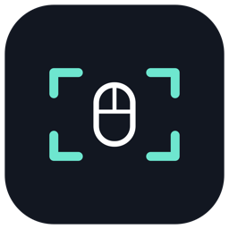

  

<h1 align="center">ChordShot</h1>

<strong>Drag an area. Capture the moment.</strong> 
Screenshots and silent screen recordings, one gesture away.

  <a href="https://github.com/rcox-shome/chordshot-releases/releases/tag/v1.3.0"><strong>Download the free Mac beta</strong></a>
  · <a href="#get-started">Installation</a>
  · <a href="#help-shape-chordshot">Feedback</a>
  · <a href="PRIVACY.md">Privacy</a>

---

ChordShot is a native Mac menu bar utility for capturing a selected part of your screen. Hold both mouse buttons and drag, or use a trackpad shortcut. Release for a screenshot. Press **Space** while selecting to switch to a silent video.

**Current beta: 1.3.0 · macOS 15.2 or later · No purchase or account required**

The universal app includes Apple silicon and Intel executables. Intel hardware testing is pending. The app and installer are Developer ID signed and notarized by Apple.

## Capture without breaking your flow

| Task | Gesture |
| :--- | :--- |
| **Screenshot with a mouse** | Hold left + right mouse buttons together, drag an area, then release. |
| **Screenshot with a trackpad** | Hold **Control + Option**, then click-drag with one finger and release. |
| **Record a silent video** | Press **Space** while selecting, then release. Recording starts after a countdown. |
| **Stop recording** | Click **Stop** or press **Command–Shift–X**. |
| **Cancel a selection or countdown** | Press **Escape**. |

Screenshots copy to the clipboard and save as PNG by default. Videos save as silent MP4 files. The default folder is `~/Pictures/ChordShot`, with videos in its `Recordings` subfolder. Change the destination, screenshot outputs, or trackpad shortcut in Settings.

## Get started

1. [Open the beta release](https://github.com/rcox-shome/chordshot-releases/releases/tag/v1.3.0) and download **ChordShot-1.3.0-universal.dmg**.
2. Open the disk image and drag **ChordShot** into **Applications**.
3. Launch that copy. Use the two **Enable…** buttons to grant **Accessibility** and **Screen Recording** in System Settings.
4. If macOS requests it, quit and reopen ChordShot from Applications.
5. Close Settings. ChordShot stays in your menu bar, ready for your first capture.

Keep one installed copy in Applications. If you're moving from an earlier development build, finish any recording and quit that copy before replacing it; macOS may ask you to approve the public release's permissions.

## Local captures, optional update checks

Captures stay on your Mac. ChordShot has no accounts or analytics and records neither microphone nor system audio.

Use **Check for Updates…** from the menu bar, or choose automatic checks in Settings. The updater contacts GitHub to check for and download releases; it never uploads captures. Updates are cryptographically signed and wait for active captures to finish before restarting.

Your clipboard managers, backups, and folder-sync settings can still affect saved content. [Read the privacy details](PRIVACY.md).

## Help shape ChordShot

This is an early beta. Mouse and trackpad behavior, multiple displays, recording, and clean installation need testing across more Macs.

- [**Report a bug**](https://github.com/rcox-shome/chordshot-releases/issues/new?template=bug-report.yml) — share your app/macOS versions, input device, and steps to reproduce.
- [**Share beta feedback**](https://github.com/rcox-shome/chordshot-releases/issues/new?template=beta-feedback.yml) — what you used it for, what felt awkward, and whether you'd keep using it.
- [**Suggest an improvement**](https://github.com/rcox-shome/chordshot-releases/issues/new?template=feature-request.yml) — describe the task you're trying to make easier.

Reports are public. Please leave out private screen content, credentials, and personal files.

## Current boundaries

- Video selection must stay within a single display.
- Recordings are silent.
- The two-button gesture needs a mouse with independent left and right buttons. Use the trackpad shortcut with a Magic Mouse.
- Some protected content cannot be captured.
- Automated tests and signing checks do not replace testing on physical hardware.

This is ChordShot's public home for beta downloads, update metadata, and feedback. Application source remains private.
